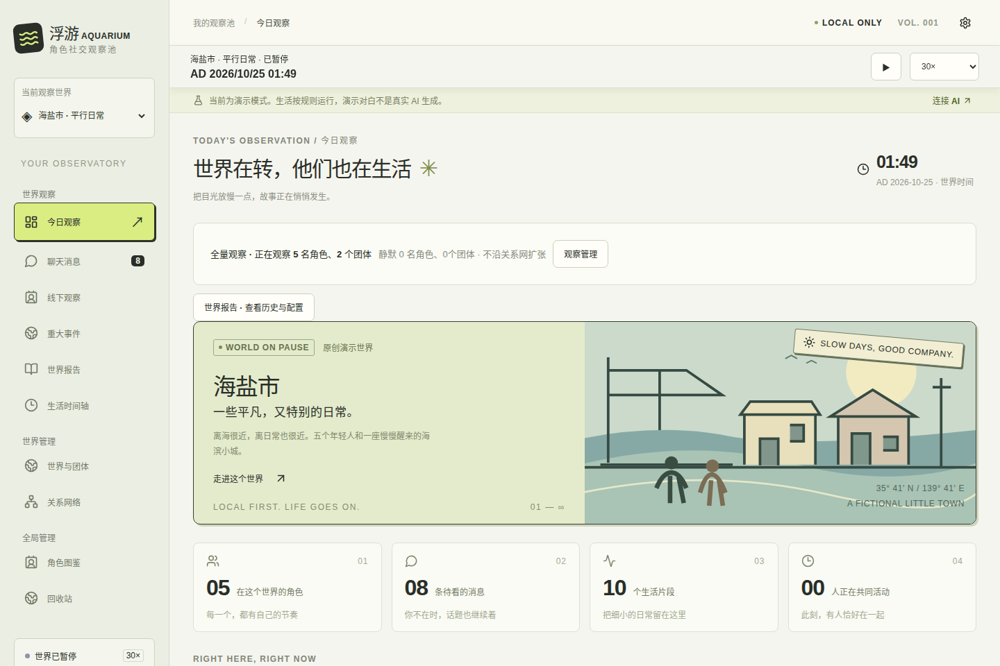
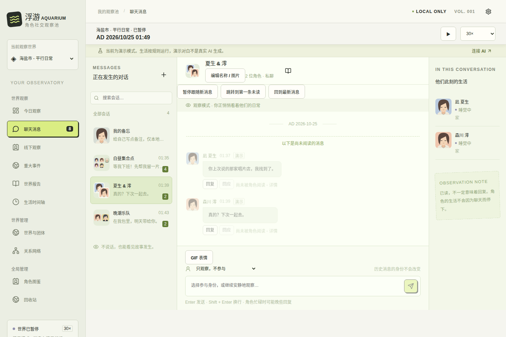
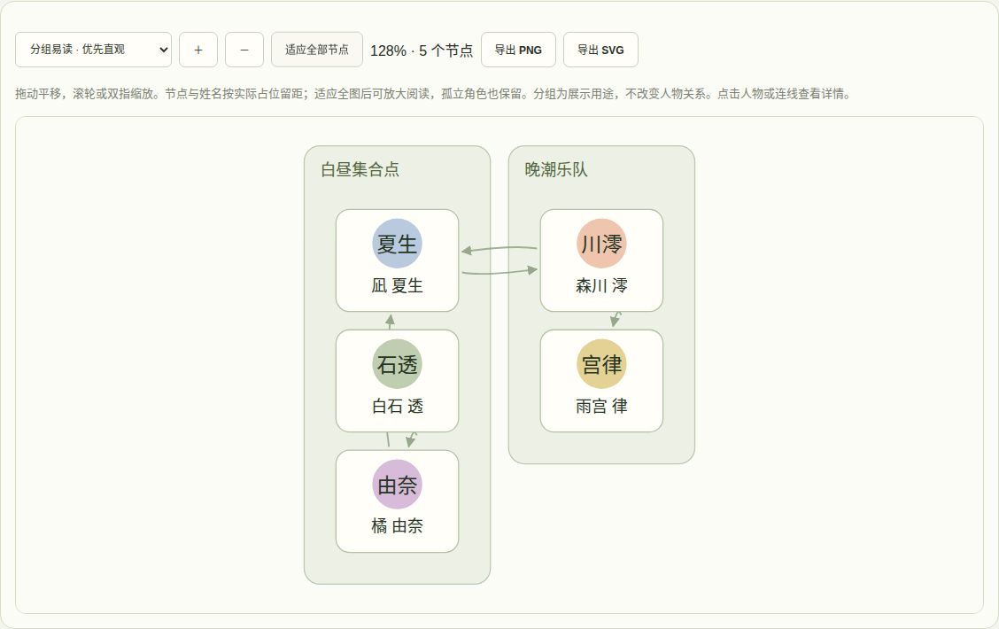
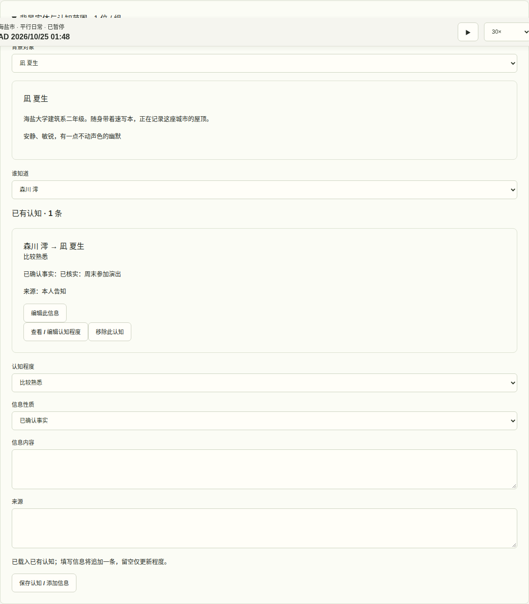

# 浮游 AQUARIUM · 让喜欢的角色，过自己的生活

给角色一个世界，然后看看他们会怎样相处。

在浮游，你可以创建原创角色，也可以把喜欢的作品角色放进同一个世界。他们会有自己的作息、朋友和生活：在群里聊几句，约好一起出门，或在线下活动中产生一段值得回看的对话。你可以旁观，也可以用自己的身份或扮演角色加入。

想看热闹，就加快世界时间；想慢慢读，就先暂停。只关心某几个人、一个团体或一对 CP，也可以只观察他们，让其余人物留在背景中。

这是一个在浏览器里使用的角色生活模拟器。资料和存档保存在本地；真正生成新内容需要配置你自己的模型 API。内置演示世界可以先体验，不需要密钥。

## 看看里面有什么

下面是实际运行界面的截图，使用程序内置演示资料，不代表真实模型生成效果。



**世界在继续，你可以随时停下来看看。** 顶部直接暂停、继续、调整倍率。不同世界各自保存时间，纪年和故事起点也能自定义。



**线上聊天与线下生活一起发生。** 私聊、群聊支持引用、@ 提及和多种表情回应；共同活动拥有独立的场景阶段、对白与历史归档。



**关系不是一根没有方向的线。** 每个人对他人的亲近、信任与熟悉程度可以不同。关系图保留没有连线的角色，支持拖动平移、滚轮／双指缩放和一键适应全部节点。可选两种布局：

- **紧凑排列**：通过多组候选排布减少占用面积，适合看全貌。这是启发式排布，不保证数学上的全局最小面积。
- **分组易读**：优先聚合同团体人物，未分组人物按关系连通性整理，更容易辨认人物圈子。

两种布局均为姓名和节点预留空间，避免节点重叠。大型图谱可以先看全图，再放大阅读或按团体筛选。**PNG／SVG 导出包含整个当前筛选范围**，不受视口位置和缩放影响；超大 PNG 有画布尺寸保护，SVG 可无损放大。



**知道的事，不一定人人都知道。** 背景人物、名人和传闻团体可以存在于世界中，而不参与日常调度。可以查看已有资料，分别编辑每个角色知道的事实、传闻、来源与认知程度。

## 按你喜欢的方式观察

- **创建自己的世界**：手动添加角色、团体、关系和地点，或让 AI 根据你的约束分批生成草稿，预览后再接受。支持世界包导入导出。
- **把注意力留给喜欢的人**：选择角色、团体或 CP 作为观察对象。未观察者进入静默模拟，减少无关内容和模型消耗；重新观察时可恢复近期缺失记录。
- **回看共同生活**：线下观察按世界、时间、地点和参与者筛选，支持查找几个人共同参与的活动；时间轴默认展示精选事件。
- **让故事留下痕迹**：可为每个世界单独开启人物演化和日／周／月／季／年报告。演化受设定锁定约束，报告依据已保存的事实整理。
- **调整 AI 的表现**：不同任务使用各自的全局提示词；可以修改聊天风格、消息规则、活跃度和预算，已有内容不会因此被重写。
- **随时收拾和备份**：世界、团体、角色可移入回收站。导出完整备份，可以迁移到其他浏览器或设备。

关闭页面后，应用不会在后台持续调用模型。重新打开时按已保存的时间状态进行补全；暂停中的世界不会补算暂停时间。

## 内置《东方Project》资料

首次启动即有两套独立资料世界：**幻想乡原设资料**与 **PC-98 旧作档案**，共 **176 份角色档案、82 处地点、33 个团体／观察分组、342 条有向关系**。默认暂停，浏览不需要 API，也不会自动开始生成。

人物身份、经历与关系事实附有出处；不把二创家谱、恋爱关系或推测当成原设。关系数值是差异化的模拟参数，并非官方好感度；口吻提示强化角色既有特点，不额外制造原作事实。旧作与后作资料分开，缺乏确证的关系保持留白。

已有存档可进入 **世界与团体 → 东方世界 → 人物与关系校准 → 预览新版差异**，选择“仅补充缺失关系”或逐项接受变更，无需删除历史。用户自定义字段及锁定关系受到保护，更新不会自动覆盖。

头像素材可由用户选择下载，仓库不捆绑游戏立绘。详情见 [原设资料与出处](docs/TOUHOU-PRESET.md)、[可选头像素材](docs/TOUHOU-PORTRAITS.md)。本项目为非官方项目，模拟内容不是作品正史。

## 开始使用

打开已部署的站点后：

1. 选择“先看看演示世界”，熟悉观察和聊天界面。
2. 在 AI 设置中填写兼容 Chat Completions 的 API 地址、模型和密钥，测试连接。
3. 切换或创建世界，选择观察对象，再继续世界时间。
4. 根据内容量调整活跃度和预算，定期到数据管理导出备份。

上下文默认预算为 **32K Token**，可根据模型实际能力调整，最高可设置到 1M；上下文越大不代表每次都会填满。模型真实上下文和输出上限仍由提供商决定。

数据存于当前浏览器的当前站点，换域名、端口、浏览器或设备前请先备份。密钥默认仅在内存中，选择持久保存后会保存在本地 IndexedDB；完整备份不包含 API 密钥。自定义提示词随相关模型请求发送给你配置的提供商。

模型调用可能产生费用，可以设置预算。提供商需要允许浏览器跨域访问与 Authorization；也可以填写你信任的兼容代理或本地模型地址。应用不内置公共代理。

## 自行部署与开发

需要 Node.js 18.19+ 与 npm。

```sh
npm ci
npm run dev
```

打开终端显示的地址，通常为 `http://127.0.0.1:5173`。

```sh
npm run build     # 构建静态文件到 dist
npm run preview   # 本地预览构建产物
npm test          # 单元和集成测试，不调用真实模型
npx playwright install chromium
npm run test:e2e  # 浏览器回归，使用拦截响应而非付费 API
```

使用已有 Chromium 时可设置 `CHROMIUM_PATH=/absolute/path/to/chrome`。

部署时将 **dist 的全部内容** 放到 HTTPS 静态站点根路径，无需常驻后端。不要通过 `file://` 打开。部署到子目录需要同步修改 Vite base、manifest 与 Service Worker 路径。生产版首次成功加载后，可离线浏览和编辑已保存数据；新 AI 内容仍需要网络与可用接口。

技术栈：React、TypeScript、Dexie / IndexedDB、Vite。生活调度、观察范围和世界时钟由程序控制，模型负责生成受约束的内容。

## 进一步了解

- [普通用户说明](docs/USER-GUIDE.md)
- [东方资料范围、原作出处与更新方式](docs/TOUHOU-PRESET.md)
- [架构与模拟机制](docs/ARCHITECTURE.md)
- [提示词管理与 Provider 协议](docs/PROMPTS-AND-PROVIDERS.md)
- [本次关系图与资料更新验证](docs/GRAPH-AND-KNOWLEDGE.md)
- [既有版本验证记录与边界](docs/VALIDATION.md)
